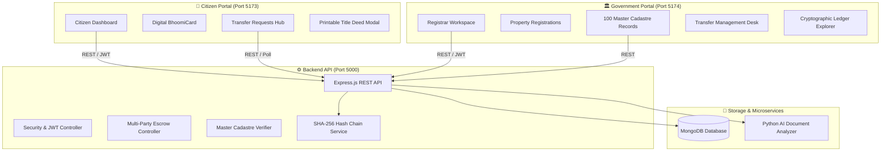

# 🇮🇳 BhoomiChain — Unified Land Records & Civil Identity Registry

> **"Own with Trust. Transfer with Proof."**  
> *A Next-Generation Decentralized Land Governance & Title Registry Architecture.*

[](https://nodejs.org/)
[](https://react.dev/)
[](https://vitejs.dev/)
[](https://www.mongodb.com/)
[](https://python.org/)
[](https://en.wikipedia.org/wiki/SHA-2)

---

## 🚀 Quick Start — How to Run the Project

To start all services locally, open **three separate terminal windows** (one for each service) and run the following commands:

### 1️⃣ Backend API Server (Port 5000)
Navigate to the `backend` folder and start the Node.js Express server:
```bash
cd backend
npm install
node src/server.js
```
*(Alternative for dev mode with auto-reload: `npm run dev`)*  
* **URL:** `http://localhost:5000`  
* **Database:** Connects automatically to local MongoDB at `mongodb://127.0.0.1:27017/bhoomichain`

> **Optional (First-time setup database seeding):**  
> To seed 100 master government land records and pre-configured demo users:
> ```bash
> cd backend
> node seed-100-gov-land-records.js
> node seed-registrar.js
> ```

---

### 2️⃣ Citizen Portal (Port 5173)
Navigate to the `citizen-portal` folder and start the Vite development server:
```bash
cd citizen-portal
npm install
npm run dev
```
* **URL:** [http://localhost:5173](http://localhost:5173)  
* Dedicated interface for landowners, buyers, and citizens to view properties, transfer requests, digital identity cards, and download printable title deeds.

---

### 3️⃣ Government / Registrar Portal (Port 5174)
Navigate to the `government-portal` folder and start the Vite development server:
```bash
cd government-portal
npm install
npm run dev
```
* **URL:** [http://localhost:5174](http://localhost:5174)  
* Dedicated terminal for Sub-Registrars (Class-I Gazetted Officers) to review deed registrations, cross-verify against 100 master cadastre records, initiate transfers, and seal transactions into the cryptographic ledger.

---

## 🔑 Demo Login Credentials (Ready for Viva & Testing)

Both portals feature **1-click auto-fill buttons** on their login screens for swift demonstration without manual typing.

### 🏛️ Government Portal (`http://localhost:5174`)
| Field | Value | Notes |
| :--- | :--- | :--- |
| **GOV ID NUMBER** | `GOV-MH-2026-001` | Gazetted Officer ID |
| **SECRET PIN** | `9801` | Statutory Officer PIN |
| **PHONE NUMBER** | `9800000001` | Registered Official Contact |
| *Officer Profile* | **Shri Anant Deshmukh** | *Sub-Registrar (Class-I) • Palghar Division* |

### 👨‍💼 Citizen Portal (`http://localhost:5173`)
| Field | Persona 1: Seller (Mehul Kasrung) | Persona 2: Buyer (Pooja Sharma) |
| :--- | :--- | :--- |
| **BID / BCID Code** | `BCID-IND-2026-000001` | `BCID-IND-2026-000002` |
| **Phone Number** | `9876543210` | `9876543211` |
| **Secret PIN** | `1234` | `1234` |
| **Aadhaar Card No.** | `5489 3210 1001` | `5489 3210 1002` |
| **Card Expiry** | `12/30` | `12/30` |
| **Secret Card Code (CVC)** | `789` | `456` |

---

## 🌟 Key Features & Innovations

### 1. 🪪 Digital BhoomiCard Identity
- Physical-style smart civil identity card issued under the Government of Maharashtra Revenue Department.
- Accessible via the **Profile Icon** in the top-right header of the Citizen Portal.
- Encapsulates:
  - **BCID (BhoomiChain Civil Identifier)**
  - **Masked Aadhaar Number**
  - **Expiry Date**
  - **Transfer Authorization Credentials** (Card Secret PIN & 3-digit CVC Code with quick-copy).

### 2. 🔄 Multi-Party Sequential Transfer Lifecycle
A strict multi-stage state machine prevents unilateral transfer and eliminates fraudulent sales:
1. **Gov Initiation:** Sub-Registrar selects Seller ID (automatically populates verified seller name, Aadhaar, and owned parcels) $\rightarrow$ selects parcel $\rightarrow$ selects Buyer ID (populates buyer name & Aadhaar) $\rightarrow$ enters consideration amount. *(Includes a 1-Click Fast Transfer Fill button for demonstrations).*
2. **Seller Consent:** Appears **only** in the Seller's *Requests* tab. Strictly hidden from the Buyer until the Seller reviews and accepts.
3. **Buyer Consent:** Becomes visible in the Buyer's *Requests* tab with complete parcel details and amount.
4. **Dual BhoomiCard Security Authorization:** Both parties must independently enter their BCID, Aadhaar, Card Secret PIN, CVC, and phone number to sign off. The system displays *"Wait for buyer/seller to complete this step"* until both confirm.
5. **Strictly Non-Cash Payment:** The seller sees *"Waiting for buyer to make payment"*, while the buyer enters payment details (**Bank-to-Bank Transfer, UPI, or Cheque/DD only; Cash is strictly forbidden**).
6. **Statutory Sealing:** Sub-Registrar reviews payment proof, approves, and permanently seals the new title into the immutable blockchain block.

### 3. 📊 Visual Amazon/Swiggy-Style Milestone Tracker
- Rendered on every transfer card in the Citizen Portal:
  $$\text{1. Initiated} \longrightarrow \text{2. Seller Consent} \longrightarrow \text{3. Buyer Consent} \longrightarrow \text{4. Security Signing} \longrightarrow \text{5. Non-Cash Payment} \longrightarrow \text{6. Blockchain Seal}$$
- Turns **emerald green with checkmarks (`✓`)** as stages complete, while active stages pulse with a **gold ring** and live status text.

### 4. 📜 Official Printable Government Title Deed (Form 7/12 & Sanad)
- Built-in certificate generator accessed via the **"Title Deed" / "Deed"** button on any verified property.
- Styled as an official Government of Maharashtra Revenue Department certificate:
  - State emblem & Ashok Stambh watermark
  - Registry Serial Number & Issue Date
  - Certified Clean & Unencumbered status
  - Parcel Cadastral Specifications & Title Holder breakdown
  - Cryptographic SHA-256 Blockchain Hash Seal & Scannable QR Code
  - Sub-Registrar digital signature stamp
  - **"🖨️ Print / Save as PDF"** button for direct printing.

### 5. 🏛️ Master Government Cadastre (100 State Records)
- Dedicated tab in Government Portal (`/master-records`) containing 100 official cadastral parcels across Maharashtra districts (Thane, Palghar, Pune, Raigad, Nashik, Nagpur).
- Filters for *All Records*, *Active on BhoomiChain*, and *Unregistered Revenue Records*.
- Detailed **Owner Info** modal for instant cadastre lookup.
- **"🔍 Check in Master Database"**: One-click verification in property registration applications to cross-verify that the applicant actually owns the land according to state revenue archives.

### 6. 🧠 AI Document Forensics & Tamper Scoring
- Automated document analysis powered by a Python service (`ai-service/analyzer.py`).
- Inspects uploaded PDF sale deeds and 7/12 extracts:
  - Optical Character Recognition (OCR) entity extraction.
  - Pattern matching for government registration seals.
  - Real vs. Fake / Tamper-Risk Scoring (Authentic vs. Suspicious/High-Risk).

### 7. ⚡ Real-Time Auto-Refresh & Live Toast Notifications
- 4-second background synchronization between portals.
- As soon as one party updates a transfer (e.g., Buyer pays or Seller signs), an animated gold-accented toast alert appears on the counterpart's screen in real time without refreshing the page.

---

## 🏛️ System Architecture



---

## 📂 Project Directory Structure

```plaintext
BhoomiChain/
├── backend/                       # Node.js + Express backend service
│   ├── src/
│   │   ├── config/                # MongoDB database connection
│   │   ├── controllers/           # Citizen, Gov, Property & Transfer controllers
│   │   ├── models/                # User, Property, Transfer, Cadastre & Block schemas
│   │   ├── routes/                # Express REST API routes
│   │   ├── services/              # Blockchain hashing & AI bridge service
│   │   └── server.js              # Server entry point (Port 5000)
│   ├── seed-100-gov-land-records.js  # Seeds 100 Maharashtra cadastral records
│   ├── seed-registrar.js          # Seeds default registrar and citizen credentials
│   └── package.json
│
├── citizen-portal/                # Vite + React Citizen Portal (Port 5173)
│   ├── src/
│   │   ├── components/
│   │   │   ├── CitizenAuthPage.jsx    # 5-field BhoomiCard login with demo buttons
│   │   │   ├── Dashboard.jsx          # Land portfolio overview & metrics
│   │   │   ├── DigitalCardModal.jsx   # Virtual BhoomiCard with PIN/CVC
│   │   │   ├── MyLand.jsx             # Land list with Title Deed & AI actions
│   │   │   ├── TitleDeedModal.jsx     # Official printable Form 7/12 & Sanad
│   │   │   ├── TransfersHub.jsx       # Multi-step escrow acceptance & payment
│   │   │   └── TransferStepTracker.jsx# Visual 6-stage Amazon-style stepper
│   │   ├── services/api.js        # Axios client for backend API
│   │   └── App.jsx                # Main shell with 4-second auto-refresh & toasts
│   └── package.json
│
├── government-portal/             # Vite + React Registrar Portal (Port 5174)
│   ├── src/
│   │   ├── pages/
│   │   │   ├── LoginPage.jsx          # Gov ID, PIN & Phone authentication
│   │   │   ├── DashboardPage.jsx      # Registrar metrics & quick desks
│   │   │   ├── MasterLandPage.jsx     # 100 Master Cadastre records explorer
│   │   │   ├── PropertyRegistrationsPage.jsx # AI review & database check
│   │   │   ├── TransfersPage.jsx      # Dynamic transfer desk with fast-fill
│   │   │   └── LedgerPage.jsx         # SHA-256 block ledger explorer
│   │   └── services/api.js        # Registrar API client
│   └── package.json
│
├── ai-service/                    # Python Document Forensics
│   ├── analyzer.py                # PyPDF / regex OCR extraction & tamper risk scoring
│   └── rules.json
│
└── README.md                      # Project documentation & run guide
```

---

## ⚖️ Statutory & Legal Compliance

BhoomiChain is engineered to reflect statutory governance standards:
* **Section 65B, Indian Evidence Act, 1872:** Cryptographically verifiable digital records and hash logs valid as secondary legal evidence.
* **Information Technology Act, 2000:** Electronic signature protocols, asymmetric encryption, and civil identity authentication.
* **Maharashtra Land Revenue Code, 1966:** Cadastral mapping parameters, Form VII-XII (7/12) attributes, and mutational title recording.

---

## 👨‍🎓 Project Credits & College Viva Demo Notice

* **Project:** BhoomiChain — Sovereign Land Governance & Civil Identity Prototype
* **Course:** Third-Year B.E. Information Technology Capstone Project
* **Developers:** Mehul Kasrung & Team
* **Target Presentation Time:** ~5–7 Minutes (Utilize the **1-Click Auto-Fill** buttons for rapid, seamless live demonstrations).

---

⭐ *If you find this project useful for academic reference or engineering demonstrations, don't forget to star the repository!*
